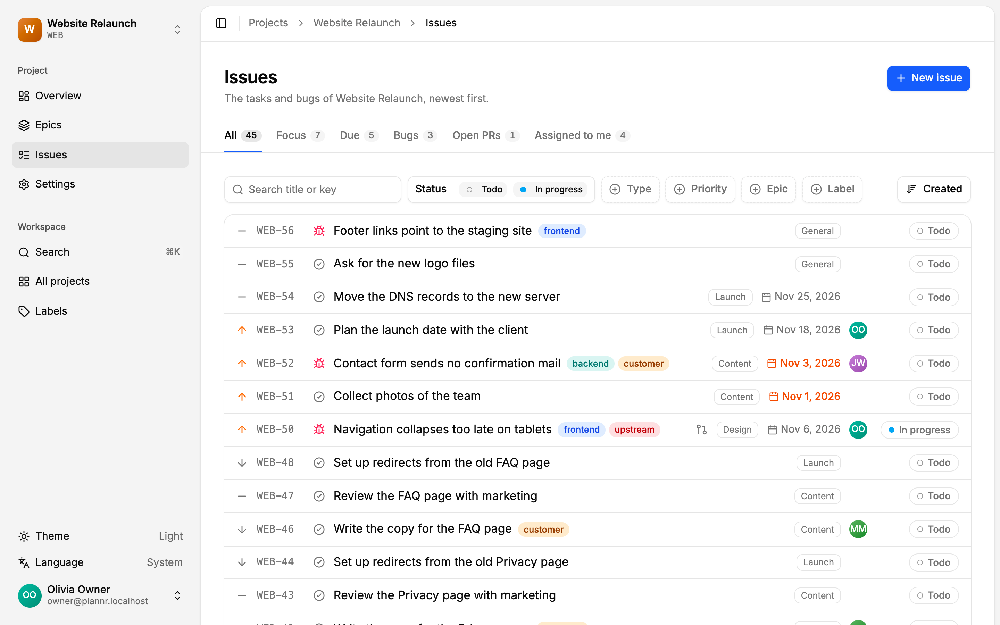
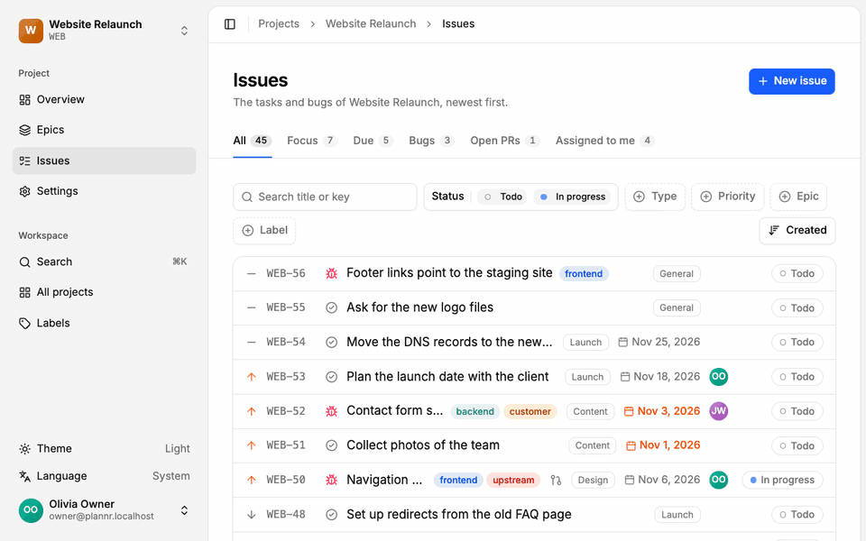
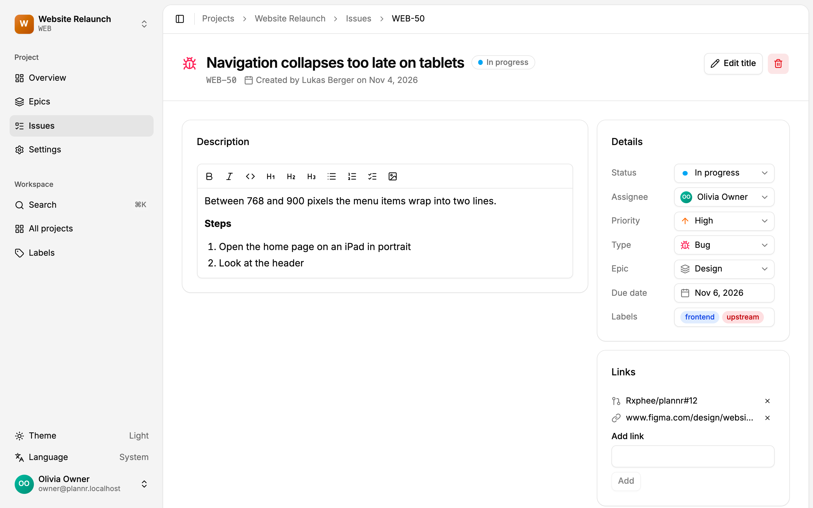
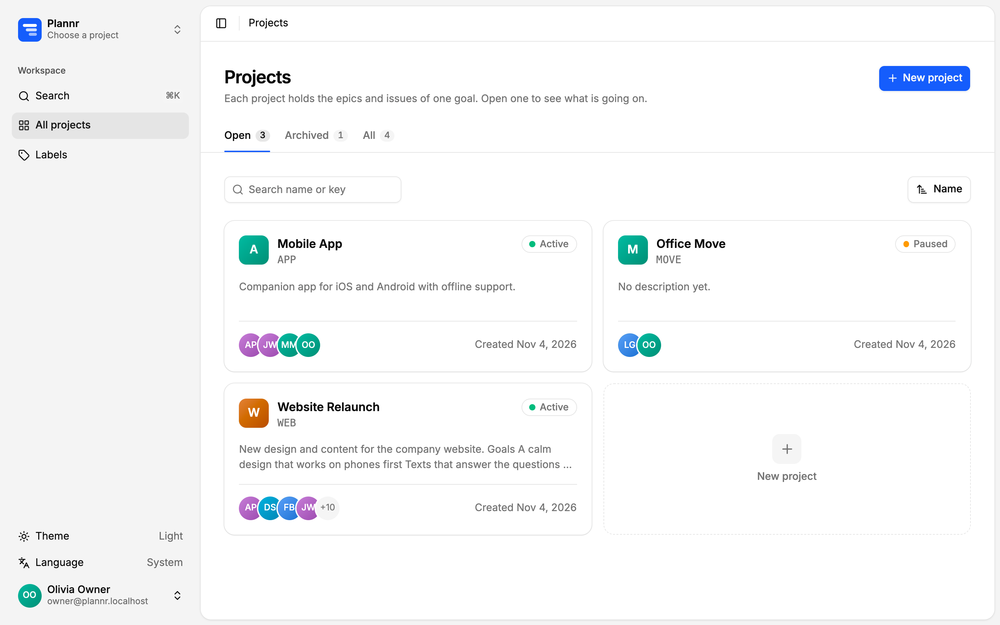

<p align="center">
  
</p>

<h1 align="center">Plannr</h1>

<p align="center">
  <strong>The lean, self-hosted issue tracker.</strong><br>
  Projects, epics and issues with clear defaults instead of endless options. Your AI agents can use it too.
</p>

<p align="center">
  <a href="https://github.com/Rxphee/plannr/releases/latest"></a>
  <a href="https://github.com/Rxphee/plannr/actions/workflows/ci.yml"></a>
  <a href="LICENSE"></a>
</p>

<p align="center">
  <a href="#quick-start">Quick start</a> ·
  <a href="docs/self-hosting.md">Self-hosting</a> ·
  <a href="docs/mcp.md">AI agents</a> ·
  <a href="CONTRIBUTING.md">Contributing</a>
</p>

<picture>
  <source media="(prefers-color-scheme: dark)" srcset="docs/images/issues-dark.png">
  
</picture>

## Why Plannr

The problem with big issue trackers is not missing features, it is that everything takes three clicks and a settings page. Plannr has one way to do each thing: projects hold epics, epics hold issues, and that is the whole model. There is nothing to configure before you can start.

## Features

- **Fast to use:** search everything with <kbd>⌘K</kbd>, capture an issue with <kbd>C</kbd> and add the details later.
- **Views that answer real questions:** Focus, Due, Bugs, Open PRs and Assigned to me, plus filters, sorting and search.
- **Issues with substance:** Markdown descriptions with checklists and images, labels, due dates, priorities, and links that recognize GitHub pull requests.
- **Made for AI agents:** a built-in [MCP server](docs/mcp.md) lets Claude Code and other agents read and change projects, epics and issues, with the same rights as the user.
- **Simple rights:** the fixed project roles owner, member and viewer, and admins for the whole instance.
- **Yours to keep:** runs on your server, signs in through your [OpenID Connect provider](docs/self-hosting.md#identity-provider), and exports each project as a ZIP file.
- **Pleasant everywhere:** light and dark theme, English and German, and a layout that works on a phone.

<p align="center">
  
</p>

<table>
  <tr>
    <td width="50%">
      <picture>
        <source media="(prefers-color-scheme: dark)" srcset="docs/images/issue-dark.png">
        
      </picture>
    </td>
    <td width="50%">
      <picture>
        <source media="(prefers-color-scheme: dark)" srcset="docs/images/projects-dark.png">
        
      </picture>
    </td>
  </tr>
</table>

## Quick Start

Try Plannr on your machine, all you need is Docker:

```sh
git clone https://github.com/Rxphee/plannr.git
cd plannr/examples/quickstart
docker compose up -d
```

Open http://localhost:3000 and sign in with `admin@plannr.localhost` and the password `Plannr-quickstart-1`.

If a port is taken, set `WEB_PORT` or `OIDC_PORT` (default 8180). `docker compose down -v` removes everything again, including the data.

This setup brings its own PostgreSQL and Zitadel, with fixed passwords and without TLS, so it is not meant for a server. It has no image uploads, as those need an S3 storage. For a real installation, see [Self-hosting](docs/self-hosting.md).

## Use It with AI Agents

Create a personal API token on the page "API tokens" and add the server, for example to Claude Code:

```sh
claude mcp add --transport http plannr https://plannr.example.com/api/mcp --header "Authorization: Bearer plannr_…"
```

Your agent can now list what is due, create issues and update them as it works. [More about MCP](docs/mcp.md)

## Roadmap

Next up are in-app notifications and dependencies between issues. Comments with a history, pull request status from GitHub, a Kanban board and milestones are ideas for later, without a promise.

## Built With

The API runs on [NestJS](https://nestjs.com) with GraphQL, [MikroORM](https://mikro-orm.io) and PostgreSQL, the web app on [Next.js](https://nextjs.org) with Tailwind CSS and [shadcn/ui](https://ui.shadcn.com).

## Contributing

Bug reports, ideas and pull requests are welcome, see [CONTRIBUTING.md](CONTRIBUTING.md) for how to run Plannr locally. Please report security problems [privately](SECURITY.md).

## License

Plannr is licensed under the [GNU Affero General Public License v3.0](LICENSE). You can use it and host it freely. If you offer a changed version as a service, you have to publish your changes.
